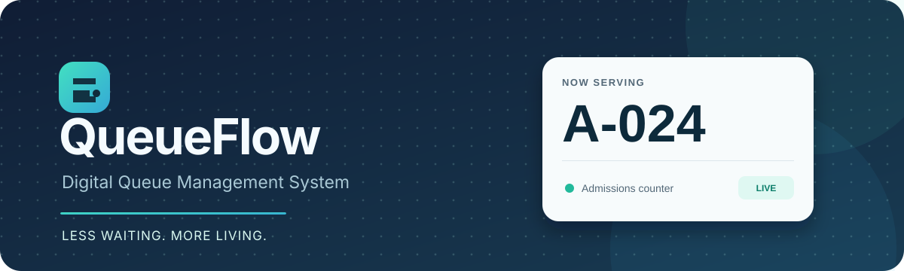

<div align="center">
  

  <h1>QueueFlow</h1>
  <p><strong>Less waiting. More living.</strong></p>
  <p>A simple, modern digital token and queue management system for clinics, college offices, and service counters.</p>

  <p>
    
    
    
    
  </p>

  <p>
    <a href="#-features">Features</a> ·
    <a href="#-screens-and-workflow">Workflow</a> ·
    <a href="#-installation">Installation</a> ·
    <a href="#-project-structure">Structure</a>
  </p>

  
</div>

---

## ✨ Overview

**QueueFlow** replaces manual waiting lists and paper tokens with a lightweight digital queue. Visitors can select a service, receive a token, and check their queue position. Staff can call or skip the next visitor, while a public display keeps the current token and waiting count visible.

Built with **plain PHP, MySQL, HTML, CSS, and JavaScript** — no frontend framework required.

## 🚀 Features

<div align="center">
  <table>
    <tr>
      <td align="center" width="33%"><h3>🎟️</h3><strong>Digital Tokens</strong><br/>Generate a unique token for each service counter.</td>
      <td align="center" width="33%"><h3>📺</h3><strong>Live Display</strong><br/>Show the currently called token and waiting queue.</td>
      <td align="center" width="33%"><h3>🛠️</h3><strong>Admin Controls</strong><br/>Call the next visitor or skip the current token.</td>
    </tr>
    <tr>
      <td align="center"><h3>⏳</h3><strong>Queue Position</strong><br/>View status and people ahead in the queue.</td>
      <td align="center"><h3>🧾</h3><strong>Queue History</strong><br/>Review waiting, called, served, and skipped tokens.</td>
      <td align="center"><h3>🌗</h3><strong>Theme & Responsive UI</strong><br/>Designed Light/Dark themes for desktop and mobile.</td>
    </tr>
  </table>
</div>

### More included

- Multiple service counters with independent token sequences and prefixes.
- Private token-status links for visitors.
- Automatic queue refresh using lightweight polling (approximately every 4–5 seconds).
- Add, pause, and reactivate service counters.
- Toast notifications, form validation, and reduced-motion support.
- PDO prepared statements, password hashing, CSRF checks, and transaction-based token numbering/queue advancement.

## 🔄 Screens and workflow

<div align="center">
  <table>
    <thead>
      <tr><th align="center">Step</th><th align="center">Visitor / Staff action</th><th align="center">What happens</th></tr>
    </thead>
    <tbody>
      <tr><td align="center">01</td><td align="center">Visitor selects a service</td><td align="center">Active service counters are displayed.</td></tr>
      <tr><td align="center">02</td><td align="center">Visitor gets a token</td><td align="center">A unique sequential token is saved in MySQL.</td></tr>
      <tr><td align="center">03</td><td align="center">Visitor checks status</td><td align="center">Queue status and people ahead are refreshed.</td></tr>
      <tr><td align="center">04</td><td align="center">Staff clicks Next</td><td align="center">The current token is served and the next waiting token is called.</td></tr>
      <tr><td align="center">05</td><td align="center">Display updates</td><td align="center">The public screen refreshes to show the latest queue state.</td></tr>
    </tbody>
  </table>
</div>

## 🧰 Tech stack

<div align="center">
  <table>
    <tr><th align="center">Layer</th><th align="center">Technology</th></tr>
    <tr><td align="center">Frontend</td><td align="center">HTML5 · CSS3 · Vanilla JavaScript</td></tr>
    <tr><td align="center">Backend</td><td align="center">PHP 8.1+</td></tr>
    <tr><td align="center">Database</td><td align="center">MySQL 8.0+ / compatible MariaDB</td></tr>
    <tr><td align="center">Database access</td><td align="center">PDO with prepared statements</td></tr>
    <tr><td align="center">Local environment</td><td align="center">XAMPP / Apache</td></tr>
  </table>
</div>

## 📦 Installation

### Requirements

- PHP **8.1 or later** (PHP 8.2+ recommended).
- PHP **PDO MySQL** extension enabled.
- MySQL **8.0+** or compatible MariaDB.
- XAMPP, or another Apache/Nginx + PHP environment.

### Run locally with XAMPP

1. **Clone the repository** into your XAMPP `htdocs` directory:

   ```bash
   cd C:\xampp\htdocs
   git clone https://github.com/YOUR_USERNAME/queueflow-digital-queue-management.git queueflow
   ```

   Or download the ZIP and extract the project folder as `queueflow`.

2. **Start Apache and MySQL** from the XAMPP Control Panel.

3. **Create the database:** open [phpMyAdmin](http://localhost/phpmyadmin), select **Import**, and import `database.sql`. The script creates the `queueflow` database and sample service counters.

4. **Check database settings** in `config.php`. The local defaults are:

   | Setting | Default |
   |:---:|:---:|
   | Host | `127.0.0.1` |
   | Port | `3306` |
   | Database | `queueflow` |
   | Username | `root` |
   | Password | *(empty)* |

5. **Create the first admin account:** visit [http://localhost/queueflow/setup_admin.php](http://localhost/queueflow/setup_admin.php). The setup page disables itself once an admin account exists.

6. **Open QueueFlow:** visit [http://localhost/queueflow/](http://localhost/queueflow/), select a counter, and generate a test token.

> **Security note:** The default database credentials are for local development only. Use a dedicated database user and strong credentials for deployment. Do not publish real passwords or secrets to GitHub.

### Environment variables

For deployment, configure the database connection using environment variables where supported by your PHP hosting environment:

```env
DB_HOST=127.0.0.1
DB_PORT=3306
DB_NAME=queueflow
DB_USER=queueflow_user
DB_PASS=change-this-password
APP_TIMEZONE=Asia/Kolkata
DB_TIME_ZONE=+05:30
```

The PHP process must be able to read these variables. Review `config.php` to confirm the configuration mechanism used by your environment.

## 🗺️ Application routes

<div align="center">
  <table>
    <thead><tr><th align="center">Page / endpoint</th><th align="center">Purpose</th><th align="center">Access</th></tr></thead>
    <tbody>
      <tr><td align="center"><code>index.php</code></td><td align="center">List active service counters and start token generation</td><td align="center">Public</td></tr>
      <tr><td align="center"><code>get_token.php</code></td><td align="center">Create the next token (POST)</td><td align="center">Public</td></tr>
      <tr><td align="center"><code>queue.php?ref=...</code></td><td align="center">View an individual token's status</td><td align="center">Token link</td></tr>
      <tr><td align="center"><code>display.php?queue_id=1</code></td><td align="center">Public live display for a counter</td><td align="center">Public</td></tr>
      <tr><td align="center"><code>admin.php</code></td><td align="center">Staff sign-in and queue management</td><td align="center">Admin</td></tr>
      <tr><td align="center"><code>setup_admin.php</code></td><td align="center">One-time first admin setup</td><td align="center">Initial setup</td></tr>
      <tr><td align="center"><code>logout.php</code></td><td align="center">End the admin session</td><td align="center">Admin</td></tr>
      <tr><td align="center"><code>api/queue_state.php</code></td><td align="center">Queue state JSON for display/admin polling</td><td align="center">Application API</td></tr>
      <tr><td align="center"><code>api/token_state.php</code></td><td align="center">Token state JSON for visitor status polling</td><td align="center">Token link</td></tr>
    </tbody>
  </table>
</div>

## 🗂️ Project structure

```text
queueflow/
├── api/
│   ├── queue_state.php
│   └── token_state.php
├── assets/
│   ├── css/style.css
│   ├── images/queueflow-banner.svg
│   └── js/app.js
├── includes/
│   ├── footer.php
│   ├── functions.php
│   └── header.php
├── database.sql
├── config.php
├── index.php
├── get_token.php
├── queue.php
├── display.php
├── admin.php
├── setup_admin.php
├── logout.php
└── README.md
```

## 🧠 Queue logic

- New tokens are created with `waiting` status and a monotonically increasing number per service counter.
- The first **Next** action calls the earliest waiting token.
- Later **Next** actions mark the currently called token as `served`, then call the earliest waiting token.
- **Skip current** marks the called token as `skipped`, then calls the next waiting token.
- Database transactions and row locking help prevent duplicate token numbers and conflicting queue advancement during concurrent requests.
- Token numbers do **not** reset automatically. Daily resets require a business-date field and a matching uniqueness rule.

## 🔐 Production checklist

- [ ] Serve the application over HTTPS and enable secure session cookies.
- [ ] Use a dedicated MySQL account with only the required database privileges.
- [ ] Set strong database and admin passwords.
- [ ] Restrict admin access appropriately for your organization.
- [ ] Configure backups, error logging, monitoring, and queue-record retention.
- [ ] Review privacy and accessibility requirements before handling real visitor data.
- [ ] Add rate limiting and audit logging before public production use.
- [ ] Consider WebSockets or server-sent events if polling is insufficient at higher traffic volumes.

## ⚠️ Project status

QueueFlow is a **functional MVP foundation** intended for learning, demonstration, and further development. It uses periodic polling rather than WebSockets to remain compatible with standard PHP hosting. It has not been presented as a fully audited, high-availability production service; test it in your own PHP/MySQL environment before relying on it for live operations.

## 🤝 Contributing

Suggestions and improvements are welcome. Fork the repository, create a feature branch, test your changes locally, and open a pull request with a clear description.

## 📄 License

Add a license file before redistributing this project. If you choose an open-source license, make sure it matches how you want others to use and modify the code.

---

<div align="center">
  <p><strong>QueueFlow</strong> · Less waiting. More living.</p>
  <sub>Built with PHP, MySQL, HTML, CSS, and JavaScript.</sub>
  <br/><br/>
  
</div>
